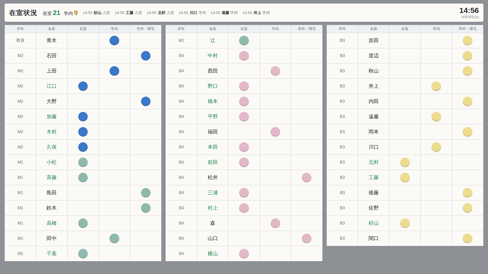

# 研究室 在室管理システム

研究室のドア前にある「マグネットを動かす在室ボード」を置き換えるためのシステムです。
学生証をカードリーダーにかざすだけで入室・退室が記録され、ドア前のモニターとWebで誰がいるかを確認できます。



## 背景と課題

- 研究室では、ドア前のマグネットボードで「在室・学内・学外/帰宅」を表示している
- マグネットの動かし忘れが多く、ボードの前まで行かないと状況が分からない
- 以前、出席のデジタル化が検討されたが「導入のハードル」と「誰が管理するか」が課題になった

そこで、**メンバーの手間を増やさない**こと、**管理の手間を最小にする**ことを重視して設計しました。

## 主な機能

- **学生証で入退室**：ICカードリーダー（Sony PaSoRi RC-S300）に学生証をかざすと、在室と退室が切り替わる
- **ドア前の表示**：今のマグネットボードと同じ「学年・名前・在室・学内・学外/帰宅」の形式で表示し、5秒ごとに自動更新
- **かざし忘れ対策**：深夜に全員を「学外・帰宅」へ自動リセット（`reset_presence` コマンド）
- **管理画面**：メンバーの追加、カードの登録（未登録カードをかざすと自動で一覧に出る）、履歴の確認

## 構成

```
[学生証] → [RC-S300] → reader_client.py ──HTTP──▶ Django（API・DB）◀── ブラウザ（ドア前モニター / Web）
```

| 部分 | 技術 |
| --- | --- |
| サーバー | Python, Django, django-ninja（API） |
| データベース | SQLite |
| カード読み取り | pyscard（PC/SC） |
| 表示画面 | HTML / CSS / JavaScript（ポーリング） |

## 設計で工夫した点

- **個人情報の扱い**：学生証のID（IDm）はそのまま保存せず、秘密鍵を使った HMAC-SHA256 のハッシュだけを保存
- **端末の認証**：カードリーダー端末はAPIキーで認証し、キーもハッシュで保存（発行時に一度だけ表示）
- **二度読み対策**：同じカードを5秒以内に読んだ場合は無視
- **今の運用に合わせたUI**：見慣れたマグネットボードと同じ表・色にして、導入時の戸惑いを減らす

## 動かし方

```bash
pip install -r requirements.txt
python manage.py migrate
python manage.py createsuperuser
python manage.py runserver
```

1. http://127.0.0.1:8000/admin でメンバーとDevice（カードリーダー）を登録し、表示されたAPIキーを控える
2. カードリーダー端末で次を実行する
   ```bash
   # Windows (PowerShell): $env:PRESENCE_DEVICE_KEY="控えたキー"
   export PRESENCE_DEVICE_KEY="控えたキー"
   python reader_client.py
   ```
3. カードをかざし、管理画面の「Cards」で持ち主を設定する
4. http://127.0.0.1:8000/ で在室状況を表示する

表示確認用に `python manage.py seed_demo` で架空のメンバーを追加できます（`--clear` で削除）。

## 今後の予定

- スマホから自分の状態（学内など）を変更する画面
- 研究室PC（Ubuntu）での常時稼働と自動リセットの設定
- 滞在時間の集計
